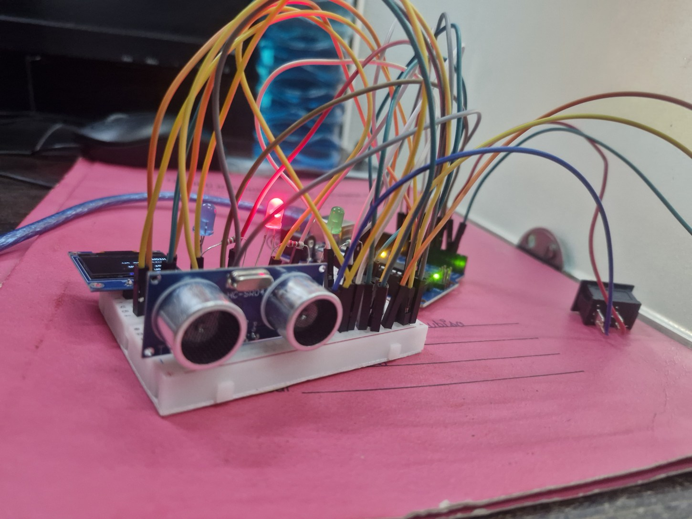
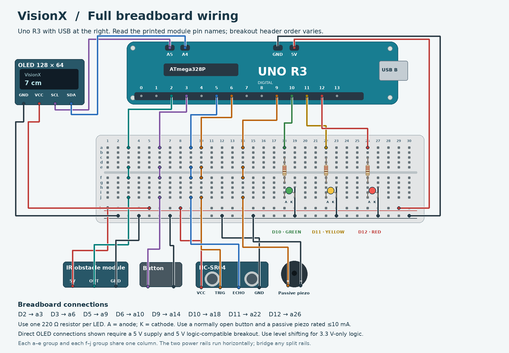
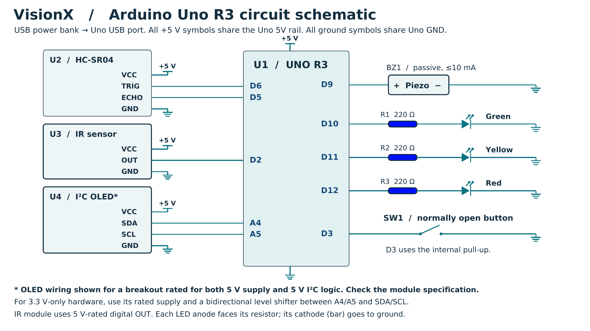
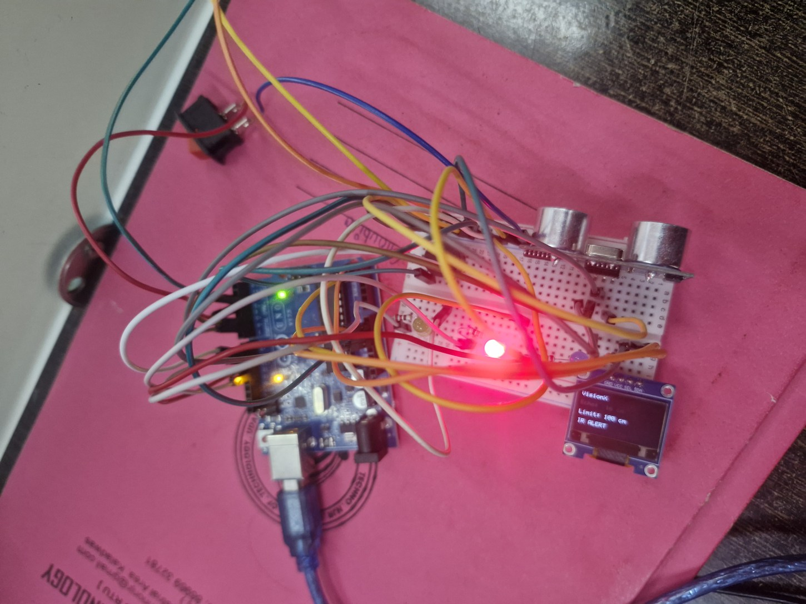
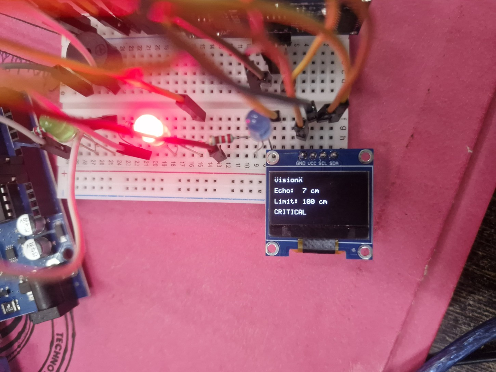
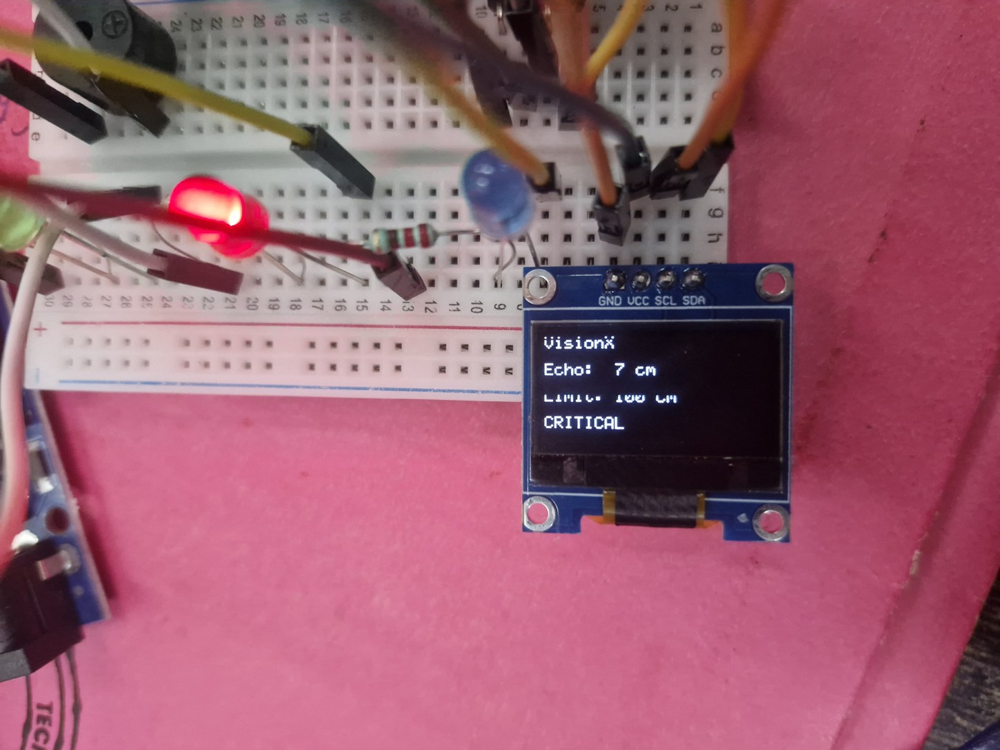

# VisionX – Intelligent Smart Walking Stick for Visually Impaired Individuals

**Beyond Sight, Towards Independence.** An offline Arduino Uno R3 cane attachment that warns of forward obstacles within a nominal metre. A short-range IR input can call for an urgent alert when the ultrasonic echo is ambiguous.

**Winner at the IoT Workshop, Techno NJR, Udaipur.**



## Circuit and assembly

Follow the coloured jumpers from the Uno headers to the breadboard holes. The drawing shows one complete placement for the default firmware. Read the printed labels on the actual modules. The direct OLED wiring requires a breakout rated for both a 5 V supply and 5 V I²C signals.



The electrical schematic shows the signal paths, LED polarity, three individual 220 Ω resistors and the common ground. Open the [vector PDF](hardware/circuit-schematic.pdf) to zoom in.



## Prototype photographs

| Complete bench assembly | OLED readout | Red indicator |
|---|---|---|
|  |  |  |

In the workshop photograph the OLED reports a **7 cm** echo, a **100 cm** warning limit and **CRITICAL**. The latest firmware enlarges the distance and alert text. The [mounting concept](hardware/smart-stick-design.png) shows how the electronics could be fitted below a cane handle.

## Build and run

1. Assemble the unpowered circuit using the [wiring table and calibration procedure](hardware/wiring-table.md), [schematic](hardware/circuit-schematic.pdf) and [breadboard guide](hardware/breadboard-wiring.png). Default hardware is a momentary button, active-low IR module and low-current passive piezo. Read the buzzer driver guidance before using an unfamiliar buzzer.
2. In Arduino IDE open [VisionX.ino](firmware/VisionX/VisionX.ino). Install Arduino AVR Boards if needed, choose **Arduino Uno**, choose the USB port, then install **SSD1306Ascii** by Bill Greiman in Library Manager. Click Verify and Upload. The bundled Wire library provides I²C. See the OLED section of the wiring guide before applying power.
3. At 115200 baud inspect cm, med (median), IR, band, range, on and nearer. A value of −1 marks unavailable range. Start with a flat target at 150 cm, move to the marked distances, then calibrate the IR trimmer. See [modes and all sound patterns](documentation/system-architecture.md).
4. Disconnect the programming cable. Supply the Uno through its USB port from a 5 V bank. Check the startup sounds and LEDs, then qualify the bank for low-load operation. Strap the enclosure under the handle with removable padded clamps. Check the grip, sweep, balance, joints and tip with a sighted operator.
5. Tap D3 to cycle 100, 60 and 30 cm. Count the confirmation beeps. Hold for 1.2 seconds to pause or resume. Pause gives a long tone and periodic reminders. A reset starts monitoring in Standard. Hardware switch position takes effect after debounce in the optional latching build.

## Simulation and repeatable checks

In the [Wokwi Uno starter](https://wokwi.com/projects/new/arduino-uno), add SSD1306Ascii in the library manager and replace the entire sketch.ino and diagram.json tabs with [the supplied files](simulation/). Press Play. Click the ultrasonic module and adjust distance. Hold the blue **IR obstacle** button to assert the digital substitute. Use **Mode** for short or long presses. For a missing-echo trial, stop the simulator, temporarily remove the D5–ECHO wire and restart. Restore the wire afterwards. The optical response and reflection geometry require a real sensor.

For Wokwi for VS Code open the simulation directory with its diagram.json, wokwi.toml and VisionX.hex, then choose **Wokwi: Start Simulator**. The HEX is the compiled default build. After firmware edits, export a new compiled binary for Uno, replace VisionX.hex with the application HEX without bootloader, and sync sketch.ino. The Wokwi diagram passed CLI lint. Hosted execution requires Wokwi access. The simulation files are included for local import.

To reproduce the offline binary tests with Node.js, run the following from the simulation directory. Network is required once to install the emulator.

```sh
npm install --no-save --no-package-lock avr8js@0.21.1
node verify.cjs VisionX.hex
```

The fixture drives the compiled sketch at its GPIO pins and checks serial telemetry and sound transitions. See the [actual results](documentation/testing-report.md) for emulator timing and outstanding physical trials.

## Project files

- [Report PDF](documentation/project-report.pdf) and [editable Word report](documentation/project-report.docx)
- [Components and power estimate](hardware/components-list.md), [rupee budget](documentation/cost-analysis.md) and [limitations](documentation/limitations.md)

Use VisionX as a supplementary educational prototype. The assembly illustration is a concept. Surface detection, runtime and accessibility await physical evaluation. Use a stationary, measured demonstration.

## Credits and licensing

Background projects and their authors are credited in the source notes. [Sources and version-specific findings](documentation/references.md). Original VisionX code and documentation use the [MIT license](LICENSE). Arduino core and toolchain components in the compiled image retain their upstream terms. See [binary notices](simulation/NOTICE.md).
